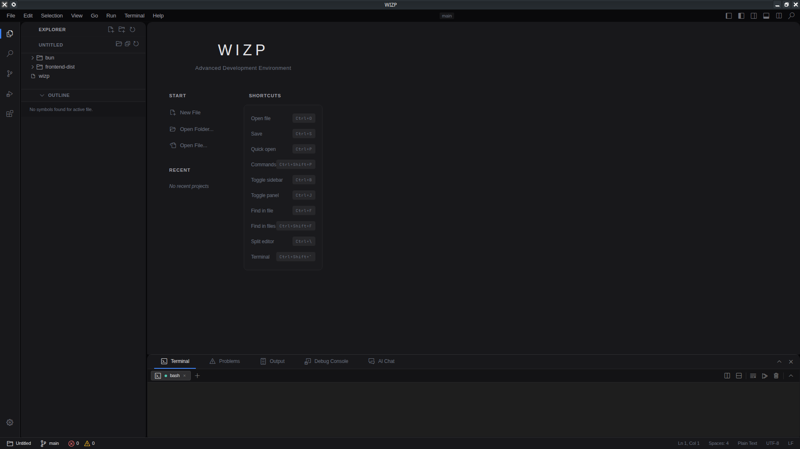
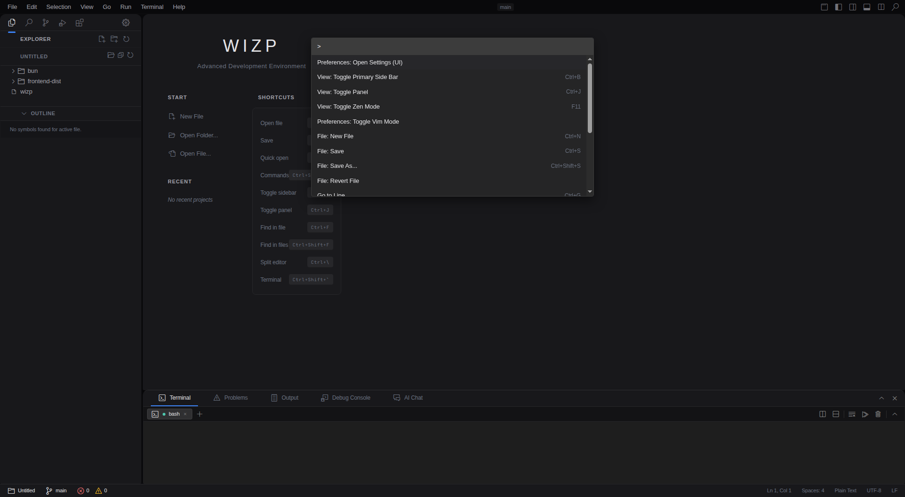

# WIZP native UI/UX deep audit

Date: 2026-07-13  
Surface: packaged Electrobun desktop application on Linux/KDE/XWayland  
Viewport: 1920 x 1080 desktop; WIZP content approximately 1920 x 1057  
Verdict: **failed baseline; deeper native workflow coverage is blocked by a repeatable crash**

Planning follow-through:

- Accepted executable queue: [`../../ui-ux/TEST_BACKLOG.md`](../../ui-ux/TEST_BACKLOG.md)
- Figma-ready placement specification: [`FIGMA_BOARD_HANDOFF.md`](FIGMA_BOARD_HANDOFF.md)
- Figma status: blocked because this workspace exposes no Figma file-creation or image-placement capability; no board URL is claimed.

## Executive result

WIZP does not yet have a stable native UI/UX baseline from which a trustworthy end-to-end suite can be built. Three fresh native launches reproduced the same failure pattern:

1. The terminal reports a ready `bash` session but renders no prompt or content.
2. The idle application generates approximately 1,070 `/api/rpc` requests in five seconds (about 214 requests/second).
3. The Electrobun main process reaches approximately 99% CPU while idle.
4. The native window disappears and the child process terminates with signal 11 / exit 139.

The launch and command-palette states were captured before failure. Editor, search, source control, debugger, extensions, settings, resizing, zoom, recovery, and complete keyboard-only journeys could not receive honest native sign-off because the application did not survive long enough to exercise them reliably.

The visual shell is coherent and promising. However, the runtime instability, blank terminal, unsafe first-run workspace, shortcut contradictions, inert-looking controls, and incomplete keyboard/accessibility semantics make the current experience unsuitable for UI/UX release approval.

## Current-run evidence

### 1. Native launch and first-run state — critical

Observed:

- The packaged application opens its own `Resources/app` directory and exposes `bun`, `frontend-dist`, and the packaged `wizp` executable as the apparent workspace.
- The workspace is simultaneously labelled `UNTITLED` / `Untitled`, making project identity ambiguous.
- The terminal panel is active, a `bash` session is selected, and the green ready indicator is present, but the terminal canvas is blank.
- The shell has consistent dark styling and clear high-level regions, but secondary text, separators, and small icon controls are difficult to scan.
- The welcome content leaves a large amount of unused space and feels visually left-weighted once the sidebar and panel are considered.
- Native OS decoration plus the in-app title bar produces a double-chrome effect.

Health: **critical**. The frame renders, but the default workspace is misleading and the primary terminal surface is non-functional.

### 2. Command palette — partially healthy

Observed:

- `Ctrl+Shift+P`, arrow movement, Enter handling, and Escape handling are implemented for the palette.
- Command grouping and the compact 600 px presentation are easy to scan.
- The input initially presents only `>` instead of a descriptive prompt.
- Selection contrast is subtle, and focus/modal context is weak.
- The input and result collection do not expose combobox/listbox relationships, active descendant, selected option, or result count semantics.
- Closing the palette forces focus to the editor rather than restoring the previously focused control.
- The blank terminal remains visible behind the palette.

Health: **degraded**. The core keyboard path is present, but semantics, focus restoration, and visual state communication need hardening.

### 3. Remaining primary journeys — blocked

The native window crashed before the following could be completed with repeatable evidence:

- open/create/edit/save/close file, including dirty-state prompts;
- project/folder selection and project switching;
- explorer expansion, selection, outline navigation, and context actions;
- search query, filters, result navigation, empty/error states, and replace;
- source-control changes, staging, commit, branch selection, and error states;
- debug start/stop/step/breakpoint and missing-configuration flows;
- extension discovery, consent, install/enable/disable, and webview flows;
- settings open, modification, save, cancel, keyboard traversal, and focus containment;
- terminal input/output, multiple sessions, split/close/restart, shell exit, and error recovery;
- panel/sidebar resizing, narrow windows, zoom, long paths, long labels, and localization stress;
- complete keyboard-only and assistive-technology traversal.

Health: **blocked by P0 runtime failure**. Static inspection below identifies likely defects, but it is not a substitute for native interaction proof.

## Runtime evidence and likely failure chain

### UX-P0-001 — Native application crashes while idle

Severity: P0  
Confidence: observed on three launches

The packaged Electrobun window disappears on every audited launch. The child terminates with signal 11 / exit 139. Additional launch diagnostics included:

- extension host termination with `error.NoJSEngine`;
- inability to connect to the accessibility bus at `/run/user/1000/at-spi/bus_0`;
- `GLXBadWindow`;
- failure to create the CEF profile under the application cache;
- Linux application-menu support reported unavailable.

Impact: all longer workflows are unreliable, unsaved work may be lost, and native UI test results after launch cannot be trusted.

Required test:

- Launch the packaged application with a clean test workspace.
- Assert the native window remains responsive for 60 seconds in pull requests and 30 minutes in a scheduled soak.
- Assert no crash signal, renderer disappearance, or unhandled child-process termination.
- Capture process CPU, memory, request rate, extension-host state, and the last native frame on failure.

### UX-P0-002 — Idle terminal polling saturates the application

Severity: P0  
Confidence: observed runtime behavior plus direct source evidence

`frontend/src/components/Terminal.svelte` continuously calls `terminalRead(sid)` inside a `while` loop. It delays for 100 ms only when an exception is thrown. A successful empty read immediately starts another request. The observed idle rate was approximately 214 `/api/rpc` requests/second, and the Electrobun main process used approximately 99% CPU.

This is the strongest identified contributor to the crash, although a causal claim still requires an instrumented run after the loop is fixed.

Required test:

- Open one idle terminal and sample RPC traffic and process CPU after warm-up.
- Fail if terminal reads exceed 10/second for an idle session or if sustained idle main-process CPU exceeds 5% on the reference runner.
- Prefer event-driven delivery or blocking/long-poll behavior; if polling remains, test an explicit bounded cadence and backoff.
- Repeat with 1, 4, and 8 terminal sessions and verify that idle cost remains bounded.

### UX-P0-003 — Ready terminal renders no prompt or output

Severity: P0  
Confidence: directly visible in the native screenshot

The selected `bash` session is labelled ready, but its visible canvas is blank. A readiness badge without observable shell output is misleading.

Required test:

- Spawn a real PTY in the packaged app.
- Assert a prompt or deterministic startup marker becomes visibly rendered within two seconds.
- Type `printf 'WIZP_UI_TERMINAL_OK\\n'` through the native terminal input path.
- Assert the marker is visible in the xterm canvas, not only present in serialized or injected test data.
- Verify non-zero terminal geometry, resize propagation, Unicode, ANSI color, paste, shell exit, restart, and error states.

## Prioritized UI/UX findings

### UX-P1-001 — First run opens product internals as the user's workspace

The native package begins in `Resources/app`, exposing implementation artifacts as explorer content. This can lead users to inspect or modify packaged files and makes “Untitled” conflict with what is visibly open.

Expected behavior: first run should show a deliberate empty/welcome state, restore a previously chosen project, or ask the user to open a folder. Product resources must never be treated as the default user project.

Future assertion: launch with no recents and verify the explorer contains no path under the packaged application directory.

### UX-P1-002 — Settings may fail while rendering default keybindings

`Settings.svelte` defines default shortcuts as `{ keys, desc }` but keys the list with `(kb.command || kb.key)`. Every default row therefore has an undefined key. This is a likely duplicate-key runtime error when Settings opens. Native confirmation was blocked by the crash.

The modal also uses `role="button"` on its backdrop instead of dialog semantics, lacks `aria-modal` and a labelled relationship, does not trap/restore focus, does not close on Escape, and gives custom controls Enter-only activation. Saving performs many sequential RPC writes while silently swallowing individual failures and exposing no saving, success, partial-failure, or retry state.

Future assertions:

- Settings opens without console/runtime errors and every list row has a stable unique key.
- Initial focus moves into the dialog; Tab stays contained; Escape closes; focus returns to the invoker.
- Enter and Space activate custom button-like controls.
- Save is atomic or clearly reports partial failure, disables duplicate submission, and exposes progress.

### UX-P1-003 — Published keyboard shortcuts contradict implementation

The UI advertises shortcuts that are absent, unreachable, or colliding:

- Welcome advertises `Ctrl+Shift+\`` for Terminal, but no matching global handler was found.
- Settings advertises `F5` for Start Debugging, but no bare F5 global handler was found.
- The F9 breakpoint branch appears after an early `if (!ctrl) return`, making bare F9 unreachable through that handler.
- `Ctrl+Shift+D` switches to Run and Debug in `Titlebar.svelte` and independently toggles the internal `wizp-debug-layout` outline mode in `App.svelte`.

Impact: shortcut help becomes untrustworthy and a standard navigation shortcut exposes developer-only visual diagnostics.

Future assertion: maintain one executable shortcut contract table. For every published shortcut, dispatch it from editor and shell-safe contexts and assert exactly one intended action and no developer side effect.

### UX-P1-004 — Production extensions view exposes a developer demo

The Extensions Hub contains `Test Webview (B3 demo)`, opens `https://example.com`, and reports a demo toast. This reads as unfinished internal scaffolding and creates an unexplained network/navigation action in a production-facing area.

Future assertion: production builds contain no demo-labelled action, example.com target, internal milestone code, or developer-only command.

### UX-P1-005 — Several surfaces look clickable but have no action

The Project, Checkout Branch/Tag, Problems, and LSP status segments use pointer cursors, hover treatments, and action-oriented titles without click handlers. Embedded Explorer outline rows also look interactive but have no navigation handler.

Impact: repeated dead clicks erode trust and make real actions harder to distinguish.

Future assertion: every hover/pointer/action-title control must either invoke its declared action by mouse and keyboard or render as non-interactive text.

### UX-P1-006 — Keyboard and assistive semantics are incomplete

Static inspection found a broad pattern of custom `div`/`span` controls with partial semantics:

- title-bar menu items sit under `role="banner"` rather than a menubar; generated dropdown rows are mouse-only plain divs;
- activity, panel, terminal, search-result, settings, and status controls commonly support Enter but not Space;
- panel and terminal tabs do not expose tablist/tab/tabpanel or selected-state relationships;
- explorer treeitems have no tree parent, place every row in the tab order, and lack arrow-key tree navigation;
- command palette lacks combobox/listbox/option relationships and active-result state;
- resizers lack orientation/value metadata and keyboard resizing;
- loading, error, result-count, and status changes are generally not announced as live regions;
- modal and picker focus is not consistently trapped or restored.

This is a static structural finding, not a claim of conformance or non-conformance to a specific accessibility standard. Native assistive-technology validation was unavailable because the accessibility bus connection failed and the app crashed.

Future assertion: semantic-role tests plus keyboard journeys for Tab, Shift+Tab, Enter, Space, Escape, arrows, Home/End, and focus restoration. Add a real screen-reader/manual lane after the native runtime is stable.

### UX-P1-007 — Extension host is unavailable without an actionable recovery state

The launch log reports `error.NoJSEngine` and extension-host termination. The visible shell does not explain the degraded state, which capabilities are unavailable, or how to recover.

Future assertion: simulate extension-host unavailable/startup-failed/restarted states and verify a persistent, actionable, non-blocking status surface.

### UX-P2-001 — Secondary contrast and boundaries are weak

Representative token pairs measured from the current CSS:

| Foreground / boundary | Background | Measured contrast |
| --- | --- | ---: |
| `#6b7280` dim text | `#18181b` panel | 3.66:1 |
| `#71717a` inactive text | `#09090b` base | 4.12:1 |
| `#a1a1aa` secondary text | `#18181b` panel | 6.91:1 |
| `#e4e4e7` primary text | `#18181b` panel | 13.96:1 |
| `#27272a` border | `#18181b` panel | 1.19:1 |

The first two text pairs and the border pair are weak screening results for normal text and interactive boundaries. They should be formally evaluated in every state and theme before making any accessibility-compliance claim.

Future assertion: automated token contrast checks plus visual review of default, hover, focus, selected, disabled, error, and high-contrast states.

### UX-P2-002 — Dense controls and narrow targets reduce precision

Multiple icon actions are approximately 22–26 px, and explorer rows are approximately 22 px high. This is compact for expert desktop use but leaves little margin for touchpads, motor variability, high-DPI scaling, and 200% zoom.

Future assertion: inventory rendered target bounds; verify critical controls remain distinct and operable at supported scaling and zoom levels.

### UX-P2-003 — Layout has weak first-run hierarchy and likely narrow-width pressure

The welcome layout uses a fixed horizontal arrangement with a 60 px gap and no obvious narrow-width adaptation. Combined with fixed shell regions and dense status controls, this risks clipping at small windows, large text, long paths, and localized labels. The wide launch frame also leaves a large inactive canvas without guiding the user toward a project-opening decision.

Future assertion: visual and interaction matrix at 1920x1080, 1440x900, 1280x720, 1024x640, 200% zoom, long project paths, long filenames, and pseudo-localized strings.

### UX-P2-004 — Native and in-app chrome compete

The OS title bar and WIZP's internal title/menu bar are both visible. The stacked bars consume vertical space and weaken the visual ownership of window controls.

Future assertion: define the supported decoration mode per platform and compare screenshots for exactly one coherent window-control treatment.

## Positive foundations worth preserving

- The dark shell, spacing rhythm, icon language, and panel architecture are visually consistent.
- Primary and secondary regions are easy to identify at a glance.
- Many controls already use native buttons and several explorer/search controls have explicit accessible names.
- The editor dirty-close prompt uses dialog semantics and provides clear save/discard/cancel choices.
- OpenVSX network consent is explicit rather than silently enabling network activity.
- Terminal lifecycle colors and labels are a useful model once they reflect actual rendered readiness.
- The command palette already implements the essential Escape, Enter, and arrow-key behavior.
- Status pickers use native buttons for option rows.

## Accepted automated UI/UX backlog

The user accepted these tests for the active planning queue. Their detailed contracts, fixtures, evidence rules, and sequencing now live in [`../../ui-ux/TEST_BACKLOG.md`](../../ui-ux/TEST_BACKLOG.md). P0 tests must run against the real packaged native window; browser/component checks cannot substitute for them.

| ID | Priority | Test contract | Layer |
| --- | --- | --- | --- |
| UI-NATIVE-001 | P0 | Packaged app launches and remains responsive for 60 s | native smoke |
| UI-NATIVE-002 | P0 | 30-minute idle survival with crash artifact capture | native scheduled soak |
| UI-NATIVE-003 | P0 | Idle RPC rate and CPU remain within explicit budgets | native telemetry |
| UI-NATIVE-004 | P0 | Real PTY prompt and typed marker render visibly | native journey |
| UI-NATIVE-005 | P0 | First run never opens packaged resources as workspace | native journey |
| UI-NATIVE-006 | P1 | Open/create/edit/save/dirty-close/reopen file | native journey |
| UI-NATIVE-007 | P1 | Explorer expand/select/context/outline navigation | native journey |
| UI-NATIVE-008 | P1 | Search results, empty, loading, error, and replace flows | native journey |
| UI-NATIVE-009 | P1 | SCM stage/unstage/commit/branch and failure states | native journey |
| UI-NATIVE-010 | P1 | Debug start/stop/step/breakpoint/configuration states | native journey |
| UI-NATIVE-011 | P1 | Extension consent/install/disable/failure/restart | native journey |
| UI-NATIVE-012 | P1 | Settings open/change/save/cancel/error/focus lifecycle | native journey |
| UI-NATIVE-013 | P1 | Terminal sessions, resize, Unicode, ANSI, exit, restart | native journey |
| UI-CONTRACT-001 | P1 | Every documented shortcut invokes exactly one action | shared contract |
| UI-CONTRACT-002 | P1 | No production demo, milestone, or example target ships | static/package |
| UI-CONTRACT-003 | P1 | Pointer/hover affordances all have actions and keyboard parity | component/static |
| UI-A11Y-001 | P1 | Menus, trees, tabs, palettes, dialogs, and resizers expose correct relationships | component semantics |
| UI-A11Y-002 | P1 | Keyboard-only traversal and focus restoration | native + component |
| UI-A11Y-003 | P1 | Live status/error/loading announcements | component + manual AT |
| UI-VISUAL-001 | P2 | Baseline shell states at supported dimensions and zoom | native visual |
| UI-VISUAL-002 | P2 | Theme/state token contrast and focus visibility | static + visual |
| UI-VISUAL-003 | P2 | Long paths, filenames, labels, and pseudo-localization | native visual |
| UI-RECOVERY-001 | P2 | Renderer, daemon, terminal, and extension-host recovery | native fault injection |

## Harness requirements

1. Use the packaged native application as the source of truth for boot, terminal, window, CEF, process, file-dialog, and crash behavior.
2. Seed a small disposable workspace outside the package directory with files, search matches, Git history, debug configuration, and a local test extension.
3. Drive real pointer and keyboard input. Do not mark a terminal test passed from injected xterm data or a backend-only response.
4. Add stable semantic selectors first; use test IDs only where a meaningful role/name cannot identify the control.
5. Capture a screenshot, process sample, request-rate sample, console tail, and accessibility snapshot on every failure.
6. Keep browser/component tests for fast semantics and state coverage, while preserving native gates for behavior that depends on Electrobun, CEF, PTY, windowing, or packaging.
7. Separate pull-request smoke, scheduled soak, platform matrix, and manual assistive-technology lanes so each claim reflects the evidence actually collected.

## Existing gate assessment

Current checks completed during this audit:

- `frontend/npm run lint`: pass.
- `frontend/npm run format:check`: pass.
- root `npm run test:parity:frontend`: pass.
- packaged native launch and survival: fail on three launches.

The passing frontend parity smoke verifies source markers and selected daemon/frontend behavior, but it does not detect native idle request saturation, visible terminal output, process CPU, CEF/profile failures, extension-host startup failure, or prolonged native survival. A generic nonblank screenshot assertion would also pass the launch frame even though its terminal is unusable.

## Release and retest criteria

Do not approve the native UI/UX baseline until all of the following are true:

- the packaged application survives the native smoke and scheduled soak without signal 11;
- idle RPC/CPU budgets pass with multiple terminal sessions;
- a real shell prompt and typed command output are visibly rendered;
- first run uses a safe, deliberate workspace state;
- Settings and all primary views open without runtime errors;
- advertised shortcuts pass a single executable contract;
- all action-looking controls are functional or visually demoted;
- keyboard focus, roles, state relationships, dialogs, menus, trees, tabs, and resizers pass the semantic/keyboard suite;
- responsive/zoom/long-content visual matrices are captured and reviewed;
- extension-host and accessibility-environment failures are either fixed or clearly surfaced with recovery guidance.

## Audit limits

- Only the two screenshots above are accepted as current native WIZP evidence. Captures obscured by an external terminal overlay or taken after renderer loss were excluded.
- No browser automation was used for this audit, and historical browser-smoke screenshots were not treated as current native proof.
- Native assistive-technology testing was blocked by the failed accessibility-bus connection and application crash.
- Figma placement was requested after the audit, but the current workspace has no Figma creation/image-placement capability. `FIGMA_BOARD_HANDOFF.md` preserves exact screenshot checksums, positions, spacing, notes, rejected-capture reasons, and acceptance checks for a later capable session.
- Responsive, zoom, localization, and most primary workflow conclusions remain unverified at runtime. Their code-level risks are listed so they can become tests, not presented as completed proof.
- Source inspection can identify contradictions and likely runtime defects, but the corresponding rows remain open until native behavior is observed after the P0 failures are corrected.
